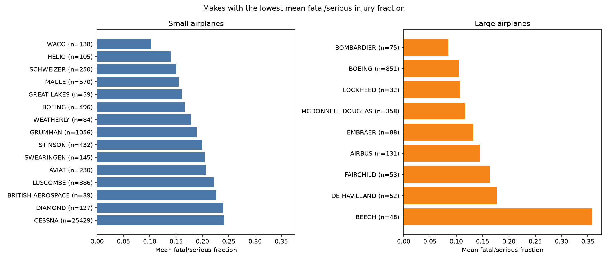
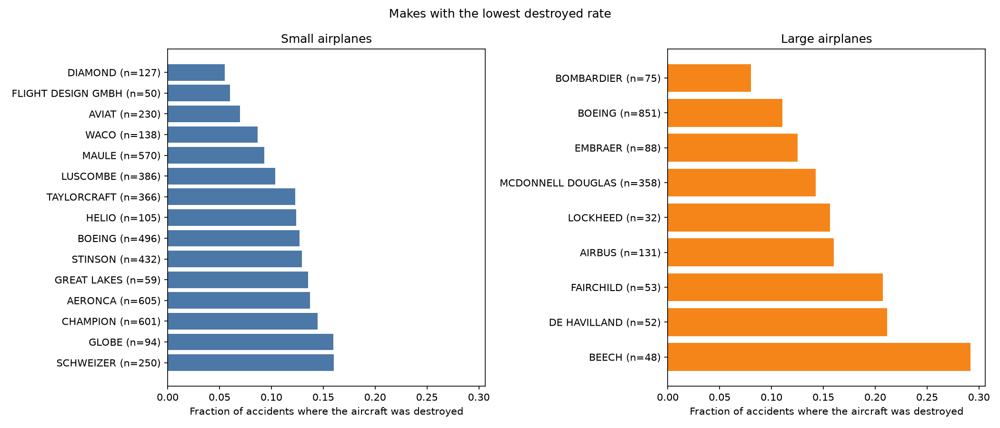
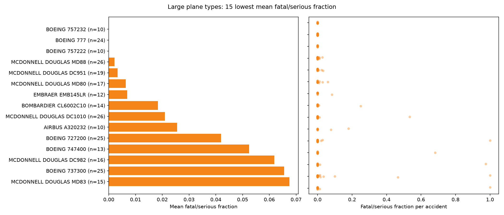
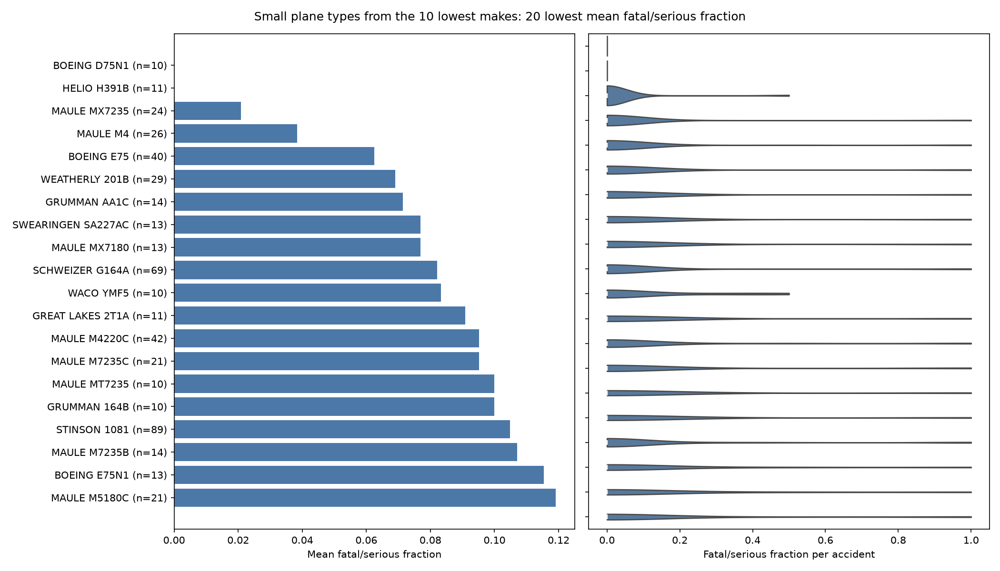
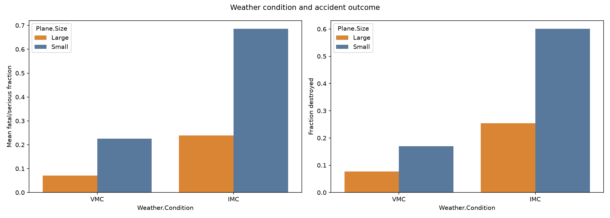
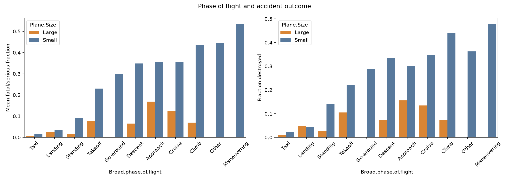
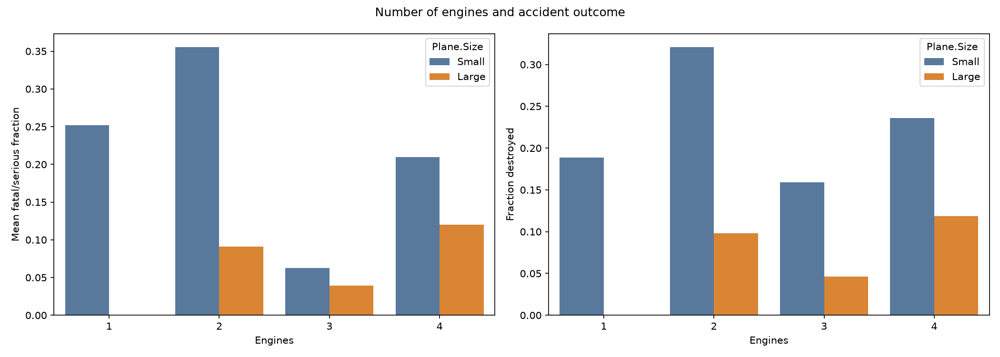

# Aviation Accident Analysis: Which Airplanes Are Safest?

## Business problem
An airline/airplane insurer wants to know which **professionally built airplanes** that could still be in service (accidents from **1983 onwards**, since a make/model is assumed to retire after at most 40 years) have a **low rate of total destruction** and a **low chance of fatal or serious injury** when an accident happens. Recommendations are made separately for **small** and **large** (passenger-liner) airplanes, and at least two contributing factors are analysed.

**Data:** NTSB Aviation Accident Database (Kaggle), 88,889 events from 1948-2022.
**Important:** the data only has accidents, so every rate here means "what happens *when* there is an accident". It does not show how often a make has accidents.

## Files
| File | Purpose |
|---|---|
| `Aviation_Accidents_Cleaning.ipynb` | Load, inspect and clean the data, create the new columns and save `cleaned_aviation_data.csv` |
| `Aviation_Accidents_Data_Analysis.ipynb` | Exploration, comparing makes and plane types, other factors, recommendations |
| `AviationData.csv` | Raw data |
| `cleaned_aviation_data.csv` | Cleaned data (59,888 rows) |
| `images/` | Plots used below |

Run the cleaning notebook first, then the analysis notebook.

## What I did
- Kept events from 1983, airplanes only (filling in missing categories for makes that are mostly airplanes) and professional builds only.
- **Fatal/serious fraction** = (fatal + serious injuries) / people on board.
- **Destroyed** = 1 if the aircraft was destroyed, 0 if not.
- Cleaned the Make column (spelling variants, company endings), kept makes with at least 50 accidents, and made a `Plane.Type` column (Make + Model) because model names repeat across makes.
- **Small vs large:** a plane type is large if the 90th percentile of people on board in its accidents is 20 or more.
- To have enough samples, makes need at least 30 accidents in their size group and plane types need at least 10. Every table shows the number of accidents.

## Key findings

### Makes

**Small airplanes** (average: fatal/serious 0.276, destroyed 0.214)
- Best on both measures: **Maule** (0.155 / 0.093, n=570), **Aviat** (0.207 / 0.070, n=230), **Diamond** (0.240 / 0.055, n=127) and **Schweizer** (0.151 / 0.160, n=250), then Stinson and Luscombe.
- Waco, Helio and Great Lakes have very low injury rates but only 59-138 accidents, so I trust them less.
- Many top makes are old, slow designs, so part of their record may come from how they are flown.

**Large airplanes** (average: 0.124 / 0.135; only 9 makes have enough accidents)
- **Bombardier** (0.085 / 0.080, n=75), **Boeing** (0.105 / 0.110, n=851), **McDonnell Douglas** (0.117 / 0.142, n=358), **Embraer** (0.133 / 0.125, n=88) and **Airbus** (0.145 / 0.160, n=131).
- The differences between these five are small. Boeing and McDonnell Douglas have the most data.
- **Beech 1900** commuters are much worse (0.358 / 0.292, n=48).

### Plane types (at least 10 accidents)

- **Large:** Boeing 777, 737-300 and 727-200, McDonnell Douglas MD-80/MD-88/DC-9/DC-10, Embraer EMB-145 and Bombardier CL-600. Older or commuter types (737-200, Beech 1900C, DC-3) are worse. Most type samples are only 10-30 accidents, so treat these as hints.
- **Small:** Maule M-4/M-7 types, Schweizer G-164A and Stinson 108-1.

### Other factors

1. **Weather:** accidents in poor visibility (IMC) are about 3 times worse than in good visibility. Small: 0.686 vs 0.225 fatal/serious. Large: 0.238 vs 0.071.
2. **Phase of flight:** maneuvering (small: 0.536) and climb (0.435) are the worst. Landing (0.035) and taxi (0.017) are the mildest.
3. **Number of engines:** small twin-engine planes do worse than singles (0.356 vs 0.252). This is probably because twins are bigger and fly more in bad weather, so I would not choose a make based on engines alone.

## Conclusion
If the client wants small airplanes that hold up well in an accident, Maule, Aviat, Diamond and Schweizer are the best supported choices. For large passenger planes, Boeing, McDonnell Douglas, Embraer, Airbus and Bombardier all did well, and Boeing and McDonnell Douglas have the most data behind them. Two things clearly make accidents worse: bad weather (IMC) and flying phases like maneuvering and climb. This data only covers accidents, so it shows how bad things get when something goes wrong and not how often accidents happen.

## Limitations
- Accident-only data, so no information on how often accidents happen.
- People on board includes crew.
- Some large makes and most large plane types have small samples.
- Results also depend on how and where planes are used (training, farming, business) and not only on the make.
